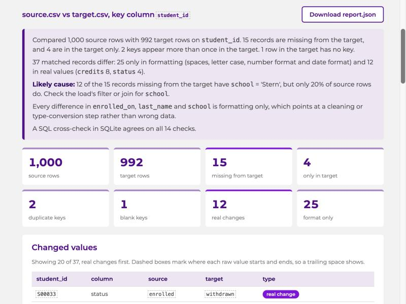

# data-compare

Compare two data sets on a key column and explain the differences in plain English: rows missing on either side, duplicate and blank keys, changed values, which changes are only formatting, and a likely cause. Every count is cross-checked in SQL.

A personal project with synthetic data, built in November 2026. The comparison is Python 3.9 or later with the standard library only. A small FastAPI server and a React page put it in the browser, and the server can save each report to a private S3 bucket.



**See a finished report:** [docs/sample-report/report.md](docs/sample-report/report.md) (the HTML version, `report.html` in the same folder, opens in any browser).

## Quick start

### Command line

```bash
python3 compare.py data/source.csv data/target.csv --key student_id --report reports
python3 -m unittest -v
```

The first command prints a summary and writes `reports/report.md`, `report.json` and `report.html`. The second runs the tests; the API tests are skipped unless FastAPI is installed (below). To regenerate the test data: `python3 make_data.py` (same seed, same files).

### Web page

Two terminals, both started in the project folder. First the API:

```bash
python3 -m venv .venv
.venv/bin/pip install -r requirements.txt
.venv/bin/uvicorn api:app --reload
```

Then the page (Node 20.19 or later):

```bash
cd web
npm install
npm run dev
```

Open http://localhost:5173 and click **Try the sample data**, or pick two CSV files and a key column. FastAPI's own test page for the API is at http://127.0.0.1:8000/docs. With the virtual environment in place, `.venv/bin/python -m unittest -v` runs all 57 tests (3 of them, for a live S3 server, are skipped unless asked for).

### Saving reports to S3

To try it without an AWS account, start the API with `.venv/bin/python run_fake_s3.py` instead of `uvicorn`. It runs the same API against a fake S3 in memory ([moto](https://github.com/getmoto/moto)), so each comparison is "saved" and can be read back, and nothing is sent to AWS.

For a real S3 server on your own computer, still free and with no AWS account, `garage.sh` runs [Garage](https://garagehq.deuxfleurs.fr/), an open-source S3-compatible server, in Docker. Reports go over the network to it, keys are checked, and saved reports survive a restart:

```sh
./garage.sh start                       # first run makes keys and a bucket in ~/.data-compare-garage
. ~/.data-compare-garage/env            # points boto3 at http://localhost:3900
.venv/bin/uvicorn api:app
DATA_COMPARE_LIVE_S3=1 .venv/bin/python -m unittest test_storage   # optional: the live-server tests
./garage.sh stop
```

Keys and stored reports stay in `~/.data-compare-garage`, outside the repository, and the server listens on 127.0.0.1 only. The code is the same for Garage and AWS: boto3 sends requests to `$AWS_ENDPOINT_URL_S3` when it is set. Connecting a real AWS bucket, with a least-privilege policy and the cleanup steps, is in [docs/s3-setup.md](docs/s3-setup.md).

## What it tells you

The summary at the top of every report, for the included test data:

> Compared 1,000 source rows with 992 target rows on `student_id`. 15 records are missing from the target, and 4 are in the target only. 2 keys appear more than once in the target. 1 row in the target has no key.
>
> 37 matched records differ: 25 only in formatting (spaces, letter case, number format and date format) and 12 in real values (`credits` 8, `status` 4).
>
> **Likely cause:** 12 of the 15 records missing from the target have `school` = 'Stern', but only 20% of source rows do. Check the load's filter or join for `school`.
>
> Every difference in `enrolled_on`, `last_name` and `school` is formatting only, which points at a cleaning or type-conversion step rather than wrong data.
>
> A SQL cross-check in SQLite agrees on all 14 checks.

Every number in it matches the answer key the test data was generated with.

## How it works

| File | Job |
|---|---|
| `make_data.py` | Makes a synthetic source file and a damaged copy, plus `planted.json`, the answer key listing every planted problem |
| `compare.py` | Loads both files, compares them by key, labels each change, finds hints, prints the summary |
| `sqlcheck.py` | Answers the same questions again in SQL (in-memory SQLite) and checks both agree |
| `report.py` | Writes the plain-English summary and the Markdown, JSON and HTML reports |
| `api.py` | The HTTP API (FastAPI): the same comparison behind three endpoints, below |
| `web/` | The React page (Vite): upload two files, read the report ([web/README.md](web/README.md)) |
| `test_compare.py` | 30 tests against the answer key and edge cases |
| `storage.py` | Optional: saves each report to S3 and reads it back by ID, when `REPORTS_BUCKET` is set |
| `run_fake_s3.py` | Starts the API with a fake S3 in memory, for trying the save without AWS |
| `garage.sh` | Runs Garage, a free S3-compatible server, in Docker on this computer |
| `test_api.py` | 9 tests for the API |
| `test_storage.py` | 15 tests for saving to S3, against the fake S3, plus a check on the policy; 3 more run against a live server on request |
| `docs/s3-policy.json`, `docs/s3-setup.md` | The app's least-privilege IAM policy, and how to connect a real bucket |
| `requirements.txt` | The packages the API, the S3 saving and their tests need |
| `styles/theme.css` | The look of both the HTML report and the web page; `styles/preview.html` is the original mockup |

| Endpoint | What it does |
|---|---|
| `GET /health` | Returns `{"ok": true}` |
| `POST /compare` | Form fields `source` and `target` (CSV files) and `key`. Returns the same JSON as `report.json`. Answers 400 with the reason for a file that cannot be compared, and 413 for a file over 10 MB. When saving is on, it also saves the report to S3 and adds a `saved` field with the report's ID |
| `GET /reports/{id}` | A saved report, read back from S3 (404 when saving is off or the ID is unknown) |
| `GET /sample/{name}` | `source.csv` or `target.csv`, for the page's sample button. The answer key is not served |

### Design notes

- **Match by key, never by position.** Each file becomes a dict from key to row, and set differences give the keys found on only one side. The target's rows are shuffled on purpose, so position-based comparison would fail.
- **Duplicate keys come first.** In a dict the last copy of a repeated key wins silently, so a comparison on a key that is not unique cannot be trusted until the duplicates are known.
- **Format-only vs real changes.** Two different strings can hold the same value: `'Tandon'` and `'Tandon '`, `'Cohen'` and `'COHEN'`, `'12'` and `'12.0'`, `'2026-09-11'` and `'09/11/2026'`. Each changed cell is tested against these rules in order (whitespace, letter case, date format, number format), and the first rule that makes the two equal is the reason. Dates with slashes are read as MM/DD/YYYY, so `11/09/2026` against `2026-09-11` is a real change.
- **Why a SQL cross-check, and why SQL alone is not enough.** The SQL answers come from a separate implementation, so agreement means neither has a counting bug (a test also confirms the check fails when Python is wrong). But SQL compares text exactly: it counts 13 changed `credits` cells, and 5 of those are the same number written differently, like `17` against `17.0`. Only 8 are real. Counting alone would overstate the problem.
- **The likely-cause hint.** For the rows missing from the target, each column is checked for one value that covers at least 80% of them but at most 50% of all rows, with at least 3 rows. Here 12 of 15 missing rows are from Stern, which is 20% of the data, so a filter or join on `school` is the first place to look. The same check runs on rows found only in the target.
- **Messy files.** Files saved by Excel with a byte-order mark are read correctly, header names with spaces or quotes work in SQL, rows with too few or too many fields are counted as malformed instead of crashing the run, repeated column names and files that are not UTF-8 are refused with a clear message, and HTML output is escaped.

### Design notes for the API and the page

- **Two front doors, one comparison.** The command line and the API call the same `load`, `compare`, `cross_check` and `build_payload` functions, and a test checks that the API's answer equals `report.json` field for field. `load()` raises `InputError` instead of exiting the program, so each front door decides what a bad file means: the command line prints the message and exits with code 1, and the API answers 400 with the same message, naming the file the user picked rather than its temporary copy.
- **CORS.** The page (port 5173) and the API (port 8000) are different origins, so the browser will not let the page read the API's answers unless the API says that origin may. `api.py` allows exactly the two dev-server addresses, and a test checks that any other origin gets no permission. Vite is pinned to port 5173 because a quiet move to 5174 would be blocked.
- **Blocking work off the event loop.** FastAPI runs `async` endpoints on one event loop. Reading the uploads is awaited; the comparison is ordinary blocking Python, so it runs in a worker thread (`run_in_threadpool`) and the server can still answer other requests meanwhile.
- **Promises in the page.** `fetch` returns a promise: a placeholder for an answer that arrives later. The browser runs the page's JavaScript on one thread, so `await` pauses only the function that is waiting, and the page keeps repainting and handling clicks. The code waits in three places: for the server's response (`await fetch`), for its body (`await res.json()`), and, behind the sample button, for both files at once (`await Promise.all([...])` starts both downloads together and resumes when the slower one arrives). `fetch` rejects only when no answer arrives at all (server down, CORS block). A 400 still resolves, so the code checks `res.ok` itself.
- **Saving to S3, with least privilege.** The app's policy (`docs/s3-policy.json`) allows two actions, `s3:PutObject` and `s3:GetObject`, on one prefix of one bucket, and a test fails if it is widened. Keys come from the environment, never from the code. Each report is stored as `reports/<time>-<random>.json`, encrypted at rest when the server confirms it (next point), and IDs are checked against that pattern before any request, so an ID like `../secret` never reaches S3. A failed save does not throw away a finished comparison: the report still comes back, with the reason it was not saved. Because the app may not list the bucket, real S3 answers a missing report with 403 rather than 404, and the error message says so.
- **Believe the server's reply, not the request.** The app asks for encryption on every upload, but Garage accepts that request, answers 200 and stores the report in plain text (Garage's documentation says it does not offer server-side encryption; tried against v2.5.0). So the app reads the reply: only when the server says `AES256` is the report marked as encrypted, and otherwise the page says the saved copy should be treated as unencrypted. For servers without encryption, `REPORTS_SSE=none` stops asking. On AWS, every new object has been encrypted by default since January 2023, so the request is a belt-and-braces measure there.
- **Testing cloud code without the cloud.** The S3 tests run against moto, a fake S3 inside the test process, with fake keys, so they need no account, no network and cost nothing. What moto does not check is IAM: the policy is tested by reading the file, and the 403 case with a stand-in client. Garage does not check it either, since it has no bucket policies; its keys are simply allowed to read and write their bucket.
- **Uploads.** Only `.csv` files, at most 10 MB each, written to a temporary folder that is deleted when the request ends. The limit protects the comparison's memory. The server has already received the upload when the check runs, so a real deployment would also cap the request size in front of the app.

### At scale

This version loads both files into memory, which is fine while they fit comfortably in RAM. For tables with tens of millions of rows I would not pull the rows into Python. I would run the comparison inside the database: compare row counts and column sums per partition (per term or per school) first, then hash each row on both sides and fetch only the keys whose hashes differ. The SQL in `sqlcheck.py` is the starting point for that.

## Tests

`python3 -m unittest -v` runs 30 core tests: every finding against `planted.json`, the format rules (13 cases), the hint thresholds (exactly 80% counts, 75% does not), edge cases (missing key column, missing file, byte-order mark, identical files, header-only file, malformed rows, an extra column, conflicting duplicates, blank keys on one side, repeated column names, a file that is not UTF-8, and the command line's one-line error message), HTML escaping, the three report files, a deliberately wrong answer that the SQL check must catch, and that `make_data.py` reproduces the committed data exactly.

With the packages in `requirements.txt` installed, 9 more test the API: its answer equals `report.json`, error messages name the uploaded file, blank keys, non-CSV and non-UTF-8 uploads are refused, the 10 MB limit holds, CORS allows only the page's origin, and the answer key is not served. And 15 test saving to S3 against the fake S3: a report reads back exactly, is stored encrypted as JSON under `reports/`, encryption is reported only when the server confirms it, `REPORTS_SSE=none` switches it off, bad IDs never reach S3, a missing bucket or a failed save is reported without losing the comparison, and the policy allows only the two actions on `reports/*`. Three live-server tests repeat the round trip, the unknown ID and the encryption check against whatever server the environment names; they pass against Garage.

To check that the tests can actually fail, seventeen bugs were introduced on purpose in throwaway copies (for example the first copy of a duplicate winning instead of the last, the hint threshold using `>` instead of `>=`, dates read as DD/MM, HTML left unescaped, CORS open to every origin, the size limit removed, encryption dropped, the encryption request trusted instead of the server's reply, the policy widened to `s3:*`). The suite failed on all seventeen.

The React page has no automated tests. It was checked by hand in a browser: the sample data, a wrong key column, the API stopped, a 375-pixel-wide phone screen, and a save to the fake S3 and to Garage, each read back by its ID (Garage's also after a restart).

## Test data

```bash
python3 make_data.py            # 1,000 rows, seed 42, writes data/
python3 make_data.py --help     # other sizes, seeds, and which school loses rows
```

| File | What it is |
|---|---|
| `data/source.csv` | The system of record: one row per student enrollment |
| `data/target.csv` | The same data after a make-believe load that went wrong in known ways, with rows shuffled |
| `data/planted.json` | The answer key: every planted problem, so the tests can check the tool finds exactly these |

Planted problems (default settings): 15 rows missing from the target (12 of them from one school), 4 extra rows, 1 row with a blank key, 2 duplicated keys, 12 real value changes (`credits` and `status`), and 25 format-only changes (trailing spaces, letter case, `12` written as `12.0`, dates written as MM/DD/YYYY). Each problem is planted on its own set of rows, so every entry in the answer key has exactly one cause.

All data is synthetic. Student IDs look like `S00001` and do not follow any real university's ID format. Names are drawn at random from two short lists.

## Design

The HTML report and the web page share `styles/theme.css`: Montserrat (falling back to Helvetica, then Arial) and a violet palette taken from NYU's public brand colors, since the sample data models a university. Body text is `#404040`, and every text and background pairing in the theme has a contrast ratio of 5:1 or better. Dashed boxes around raw values make trailing spaces visible.

## What's next

- Connect a real AWS bucket ([docs/s3-setup.md](docs/s3-setup.md)); so far saving has run against the fake S3 and a local Garage server, not AWS
- A `validate` mode that checks one table on its own: required columns, value ranges, freshness
- A GitHub Actions workflow that runs the tests on every push

## Notes

Built with AI-assisted development (Claude Code). Every result is checked by the test suite against the answer key.

A personal project, not affiliated with or endorsed by NYU. It uses no NYU logo, seal or wordmark.
